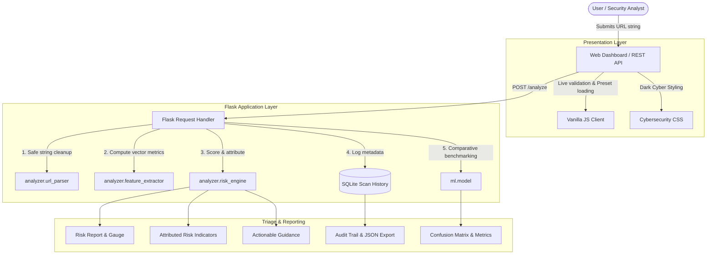

# 📘 PHISHGUARD: System Architecture & Technical Documentation

This document provides a comprehensive technical overview of the **PHISHGUARD – Phishing URL Detection & Risk Analysis System**, covering its design philosophy, data flows, heuristic calculations, database schema, and test coverage.

---

## 1. High-Level Architecture Diagram

---

## 2. End-to-End Data Flow Explanation

1. **Input Ingestion & Boundary Defense:**
   - The user enters a candidate URL string in the dashboard input field or submits it via `POST /api/analyze`.
   - Length check guards against buffer overflow / DoS attacks by enforcing a maximum of 2,048 characters.
   - Non-printable control characters (`\x00-\x1f\x7f`) are stripped in-memory.

2. **Safe Normalization (No Network Footprint):**
   - If the URL lacks an explicit protocol scheme (e.g., `paypal-login.com/secure`), the engine safely prepends `http://` for parsing.
   - `urllib.parse.urlsplit` decomposes the string into `scheme`, `netloc`, `path`, `query`, and `fragment`.
   - The hostname is lowercased and analyzed for IDN/Punycode representations (`xn--`).
   - `ipaddress.ip_address` evaluates whether the hostname is an IPv4 or IPv6 address.

3. **Multi-Vector Feature Extraction:**
   - **Lexical Dimensions:** URL length, hostname length, path length, query length.
   - **Character Frequencies:** Dots count in hostname and path, hyphens, underscores, slashes, digit-to-letter ratios.
   - **Shannon Entropy:** Computed on hostname characters to detect pseudo-random Domain Generation Algorithms (DGA):
     $$H(X) = -\sum_{i=1}^{n} P(x_i) \log_2 P(x_i)$$
   - **Threat Intelligence & Keyword Matching:** Cross-referenced against curated datasets of high-abuse TLDs, URL shorteners, target enterprise brands, and urgency keywords.

4. **Transparent Risk Engine Attribution:**
   - Every detected anomaly adds weighted risk points with an explicit severity level:
     - `Critical` (+35 to +40 pts): Direct IP address host, brand spoofing in subdomains.
     - `High` (+30 to +35 pts): Credential `@` symbol, Punycode homograph mimicry.
     - `Medium` (+15 to +25 pts): High-abuse TLDs, lack of HTTPS, URL shorteners, excessive subdomains (>=3), high entropy (> 3.9 bits).
     - `Low` (+8 to +10 pts): Excessive URL length, percent-encoding, repeated separators (`--`, `..`).
   - The accumulated score is clamped between 0 and 100.
   - Associated educational rationales explain to the user *why* each indicator poses a risk.

5. **Local Persistence (Privacy-by-Design):**
   - The scan timestamp, normalized URL, hostname, score, and classification are recorded in SQLite.
   - Passwords, cookies, query parameter authentication tokens, and user identities are never retained.

---

## 3. Module Breakdown & Responsibilities

| File Path | Module Role | Key Functions / Classes |
| :--- | :--- | :--- |
| `app.py` | Application controller, web routes, REST API, error handlers | `create_app()`, `index()`, `analyze()`, `api_analyze()`, `history()`, `ml_dashboard()` |
| `config.py` | Configuration constants, thresholds, sample test presets | `Config.RISK_SAFE_MAX`, `Config.SAMPLE_URLS` |
| `analyzer/url_parser.py` | Safe URL normalization, component extraction, and IP host checks | `parse_url()`, `normalize_url()`, `check_is_ip_address()`, `SafeParsedURL` |
| `analyzer/feature_extractor.py` | Lexical, structural, and behavioral feature calculations | `extract_features()`, `calculate_entropy()`, `URLFeatures` |
| `analyzer/risk_engine.py` | Rule-based explainable risk evaluation and indicator attribution | `evaluate_url_risk()`, `RiskReport`, `RiskIndicator` |
| `analyzer/tld_dataset.py` | Threat intelligence lists of abused TLDs, shorteners, and brands | `SUSPICIOUS_TLDS`, `SHORTENER_DOMAINS`, `TARGET_BRANDS`, `SUSPICIOUS_KEYWORDS` |
| `database/db.py` | SQLite connection, table schema, persistence, filtering, stats | `init_db()`, `save_scan()`, `get_recent_scans()`, `clear_history()`, `get_scan_stats()` |
| `ml/dataset.py` | Curated balanced benchmark dataset of 120 verified URL patterns | `BENCHMARK_URLS` (60 Legitimate, 60 Phishing) |
| `ml/model.py` | Feature vectorization, scikit-learn Random Forest model, and fallback | `extract_numeric_vector()`, `train_and_evaluate_model()`, `load_cached_metrics()` |
| `ml/train.py` | CLI training runner printing confusion matrix and feature rankings | `main()` |

---

## 4. Deep-Dive Feature Explanations

### 4.1 Hostname IP Address Detection
- **Mechanism:** Passes hostname into Python's native `ipaddress.ip_address` module after stripping brackets. Also evaluates 8-11 digit integer representations (e.g. `2130706433` -> `127.0.0.1`).
- **Cybersecurity Rationale:** Legitimate companies spend significant marketing and technical resources acquiring and maintaining SSL certificates tied to registered domain names. Phishing operators frequently deploy servers on ephemeral virtual private servers (VPS) without registering domains to evade registrar take-downs.

### 4.2 Brand Spoofing in Subdomain or Path
- **Mechanism:** Checks if known high-value brand names (e.g. `paypal`, `apple`, `microsoft`, `chase`) appear anywhere within the subdomain or directory path when the registered second-level domain (SLD) is *not* that brand.
- **Example:** In `http://paypal.com.verify-billing.xyz/login`, the apex domain is `verify-billing.xyz`, but the attacker inserted `paypal.com` into the subdomain. This is a classic visual spoofing technique.

### 4.3 RFC 3986 Userinfo `@` Symbol Exploitation
- **Mechanism:** Detects the presence of `@` in the URL string.
- **Cybersecurity Rationale:** According to Internet standard RFC 3986, characters preceding an `@` symbol are treated as HTTP Basic Authentication userinfo, while the actual host follows the `@`. For example, in `https://google.com@evil-phishing-host.com/`, the user's browser ignores `google.com` and connects directly to `evil-phishing-host.com`.

### 4.4 Punycode / Internationalized Domain Name (IDN) Mimicry
- **Mechanism:** Detects `xn--` prefix in the ASCII representation of the hostname.
- **Cybersecurity Rationale:** Homograph attacks substitute visually indistinguishable Cyrillic or Greek characters for Latin characters (e.g. Cyrillic `а` vs Latin `a`). Browsers convert these into Punycode (`xn--...`), exposing domain impersonation attempts.

### 4.5 Shannon Entropy for DGA Detection
- **Mechanism:**
  $$H = -\sum_{c} p(c) \log_2 p(c)$$
- **Cybersecurity Rationale:** Domain Generation Algorithms (DGAs) generate pseudo-random strings (e.g., `x7k9p2m4q8v1.biz`) to establish resilient command-and-control (C2) channels and disposable landing sites. These produce entropy values significantly higher (> 3.9 bits) than typical human-readable brand names.

---

## 5. Sample Test Cases

| Test Case Name | Input URL | Expected Score | Expected Classification | Key Indicators Triggered |
| :--- | :--- | :---: | :---: | :--- |
| **Search Engine (Safe)** | `https://www.google.com/search?q=cybersecurity` | 0 | `Likely Safe` | Standard web conventions, TLS active |
| **Online Encyclopedia (Safe)**| `https://en.wikipedia.org/wiki/Phishing` | 0 | `Likely Safe` | Standard domain hierarchy, HTTPS active |
| **Masked Shortener (Suspicious)**| `http://tinyurl.com/account-verification-step1` | 40 | `Suspicious` | URL shortener cloaking, Plain HTTP, Urgency keyword |
| **Abused TLD (Suspicious)** | `http://free-gift-card-bonus.top/claim-now` | 40 | `Suspicious` | High-abuse TLD (`.top`), Plain HTTP |
| **Direct IP Host (Phishing)**| `http://192.168.1.100/paypal/login.php` | 85 | `Potential Phishing` | Direct IPv4 host, Brand spoofing in path, Plain HTTP, Login keyword |
| **Punycode Homograph (Phishing)**| `http://xn--microsft-e1a.com/security/login` | 65 | `Potential Phishing` | Punycode IDN homograph, Plain HTTP, Security keyword |
| **RFC Credential Trick (Phishing)**| `https://paypal.com@attacker-site.tk/auth` | 95 | `Potential Phishing` | RFC `@` trick, High-abuse TLD (`.tk`), Brand keyword, Auth keyword |
